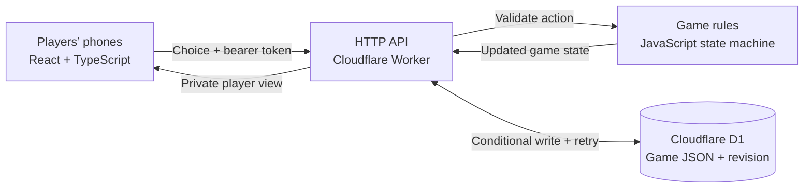

# Mafia — Game Night

**A multiplayer social-deduction game that brings a room of friends together through their phones.**

Originally a SwiftUI/Firebase project, Mafia evolved into a deployed web app with private player views, a server-authoritative game engine, and persistent shared lobbies. Players discuss in person while the app manages hidden roles, ordered night turns, recruitment, nominations, votes, and victory conditions.

**[Play the live app](https://mafia-game-night-jf.jfriar606317.chatgpt.site)** · [Architecture walkthrough](docs/ARCHITECTURE.md) · [Development and full rules](web/README.md) · [Resume and interview notes](docs/RESUME.md)

## What the project demonstrates

- **Full-stack delivery:** a responsive React interface, HTTP API, Cloudflare Worker runtime, and a persistent D1 database.
- **State-machine design:** validated transitions across lobby, role reveal, five ordered night groups, discussion, nominations, voting, verdict, and game over.
- **Conflict-safe multiplayer updates:** optimistic concurrency with a database revision check and bounded retries prevents simultaneous requests from silently overwriting each other.
- **Player-specific privacy:** the server returns each player a filtered view, withholding other teams’ roles, individual ballots, night actions, and private investigation notes.
- **Domain modeling:** role and team are separate, so a recruited Medic remains a Medic while joining the Mafia and retaining their remaining powers.
- **Verification:** 41 automated rule and turn-alert tests, plus API integration scripts for the game loop, recruitment, and ordered night turns. A nine-player API scenario has been checked against the deployed app.

## How to play

1. Gather 4–24 players in person. Each player opens the app on their own phone.
2. The host creates a lobby and shares its six-digit code.
3. The host chooses one role per player and a separate recruitment allowance for the Godfather.
4. Everyone privately reveals their role. The app guides the table through the game.

Night groups act in order: **Mafia → Cops → Vis → Medic → Diddy**. Empty groups and spent Vis powers are skipped; Medic wakes only after a kill attempt. Recruited players join Mafia discussion and still take their original role’s turn.

During the day, the first player with two nominations goes on the block and chooses a second nominee. Those two players cannot vote. The Judge may overturn a verdict once per game, and the host may skip the block before the verdict. Town wins when no Mafia remain; Mafia wins when it equals or outnumbers Town.

Turn vibration is best-effort and browser-dependent. A visible turn banner is always available. Keep the page open and phone unlocked. To simulate several players on one computer, use separate browser profiles or different browsers: ordinary tabs share the saved player session.

## Architecture



The client polls approximately every **1.8 seconds**; synchronization uses HTTP polling rather than WebSockets. All gameplay decisions are validated by the server. Each lobby is stored as a JSON document with a numeric revision. A write succeeds only if the stored revision still matches the revision read by that request; otherwise, the API rereads the latest state and retries.

| Layer | Implementation |
| --- | --- |
| Interface | React 19, TypeScript, responsive CSS, Lucide icons |
| Framework and build | Vinext with Next.js-style App Router APIs, Vite |
| Server | Cloudflare Workers |
| Persistence | Cloudflare D1 (SQLite), Drizzle schema and SQL migration |
| Rules engine | Framework-independent JavaScript module |
| Validation | Node.js built-in test runner, TypeScript checks, HTTP integration scripts |
| Hosting | Sites deployment workflow |
| Original prototype | SwiftUI and Firebase; retained for project history |

## Run locally

Requires **Node.js 22.13 or newer** and npm.

```sh
git clone https://github.com/JFriar11/Mafia.git
cd Mafia/web
npm run install:ci
npm run build
```

Initialize the local database once:

```sh
node --import ./scripts/sites-env.mjs ./node_modules/wrangler/bin/wrangler.js d1 execute DB --local --config dist/server/wrangler.json --persist-to .wrangler/state --file drizzle/0000_black_annihilus.sql
```

Start the development server:

```sh
npm run dev
```

Open the URL printed by the server, normally `http://127.0.0.1:5173`. Local data and hosted data are separate. The web app does **not** need the original Firebase account. Apply each SQL migration only once to a fresh local database.

## Verify the app

From `web/`:

```sh
# Rules and turn-alert unit tests
node --test tests/*.test.mjs

# TypeScript checks
npx tsc --noEmit

# Production build
npm run build
```

With the local development server running, exercise independent player sessions:

```sh
node tests/api-smoke.mjs
node tests/recruit-api-smoke.mjs
node tests/night-api-smoke.mjs
```

The integration scripts create dedicated test lobbies. They cover permissions, reconnect reads, role privacy, nominations, voting, host controls, retained recruitment powers, and ordered night turns. `BASE_URL` can target another deployment. The unit tests check vibration requests and unsupported-browser handling with a mock device; physical phone vibration still requires a device test.

## Repository map

```text
Mafia/
├── README.md                     # Project overview and setup
├── docs/
│   ├── ARCHITECTURE.md            # Request flow and design tradeoffs
│   └── RESUME.md                  # Resume bullets and interview talking points
├── web/                          # Current, deployed web application
│   ├── app/page.tsx               # Interactive player/host interface
│   ├── app/api/game/route.ts      # API, authorization, revision-checked writes
│   ├── lib/game.mjs               # Roles, actions, transitions, private views
│   ├── lib/turn-alert.mjs         # Turn-cue eligibility and vibration fallback
│   ├── db/                       # Drizzle schema
│   ├── drizzle/                  # Versioned database migration
│   ├── tests/                    # Unit tests and API integration scenarios
│   └── public/images/            # Game artwork
├── Mafia/                        # Original SwiftUI implementation
├── Mafia.xcodeproj/              # Original Xcode project
└── Pictures/                     # Original artwork files
```

The original iOS code is preserved as a prototype, not as the tested release target. The active application is under `web/`. Deployment helpers and their bundled licenses are retained with the web source.

## Tradeoffs and next steps

The JSON-per-lobby model keeps this small party game straightforward and makes updates atomic through revision checks. It has not been benchmarked for large-scale traffic. Polling trades some latency and request volume for a simpler deployment model.

Browser storage contains a reconnect key for the current player. Clearing it loses that session; there is no account recovery. The host can intentionally advance missing players, but cannot inspect private opposing roles through the API. Public API rate limiting, automatic stale-lobby cleanup, browser-driven UI coverage, and measured load tests are future improvements.
