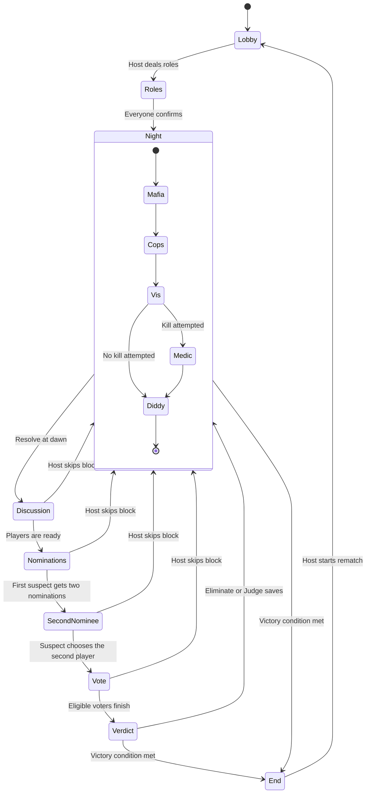

# How Mafia works

Mafia is a shared referee for an in-person game. The table handles conversation; the application handles secret information and consistent rules.

## A choice, end to end

Suppose the Godfather selects a player to recruit.

1. The React client sends `POST /api/game` with the lobby code, action type, target ID, and the device’s player token in an Authorization header.
2. The API loads that lobby’s JSON state and revision from D1.
3. `act()` identifies the player by token and checks that the player is alive, the Mafia turn is active, the target is eligible, the choice is not already locked, and recruitment allowance remains.
4. The rules engine records the action and spends one recruitment. When every current group member is ready, it advances to the next eligible group.
5. The API writes the updated state only if the database revision still matches the revision it read.
6. If another request won that write race, the API loads the newer state and tries the action again. It retries up to eight times, then asks the client to retry if the lobby is still busy.
7. The server returns `view()` for that player, with private information removed. Other devices see the change through their next poll.
8. At dawn, recruitment changes the surviving target’s team to Mafia. Their original role and spent abilities remain intact.

The SQL update follows this shape:

```sql
UPDATE games
SET state = ?, revision = revision + 1, updated = ?
WHERE code = ? AND revision = ?;
```

This matters when two players submit at once: both requests cannot successfully replace the same revision. The request that retries is checked against the new game state, so it may also be rejected if another player has already closed that phase.

## The state machine



Empty night groups are skipped automatically. Vis is also skipped after spending the one-shot power. Mafia members confirm their discussion; the Godfather submits the Mafia action. A recruited Cop participates in Mafia discussion and later receives a separate Cop turn. The current group’s participant list is fixed when that turn begins, so spending a one-shot ability cannot remove a player from completion tracking midway through the turn.

Deaths resolve at dawn, allowing a targeted player to take their scheduled turn. Medic protection cancels night kills against the protected player. Cop results use the target’s alignment before that night’s recruitment. Day actions such as Kazee’s sacrifice can also end the game immediately or invalidate an existing nominee pair.

## Role is different from team

A player has a **role**, such as Medic, and a **team**, Town or Mafia. The role defines available powers; the team defines allies and victory conditions.

Recruitment changes the team rather than replacing the role. A recruited Medic can protect the Godfather, a recruited Cop can investigate, and a recruited Vis retains only the power they have not already spent. Recruitment does not grant a new night-kill ability. The Godfather’s allowance is separate from the initial role deck.

## Privacy boundary

The database stores the complete lobby. Devices receive filtered views:

| Information | Visible to |
| --- | --- |
| Lobby code, names, living/dead state, public recap | Lobby participants |
| Own role and team | That player |
| Mafia teammates’ roles and teams | Mafia members |
| Private Cop notes | The investigating Cop |
| Remaining recruitment allowance | The Godfather |
| Current night participant IDs and other players’ readiness | Withheld from client views |
| Individual ballots, nominations, and submitted night actions | Withheld from client views |
| All roles and teams after game over | Lobby participants |

Hiding buttons alone would not enforce these rules. The API validates actions, and the view serializer removes secrets before sending data to a phone.

## Device sessions and turn cues

Creating or joining a lobby generates an unguessable player token. The browser saves the lobby code and token in local storage. The public player ID is distinct from the token. Refreshing restores the same player; ordinary tabs share the same saved session.

Every roughly 1.8 seconds, the client requests a fresh view. A turn key combines lobby, round, group, and player. The client requests a short vibration once for each eligible unfinished turn and displays a clear banner. Browser support, prior interaction, device settings, and visibility can affect vibration; there is no guaranteed background or lock-screen notification system.

## Why this design

- **Pure rules module:** domain behavior can be tested without a browser, database, or Worker.
- **One JSON document per lobby:** convenient for small, bounded party games and atomic revision-checked updates.
- **HTTP polling:** simple request/response deployment without a persistent socket server.
- **Server-side views:** one place to enforce private-information boundaries across host, Town, and Mafia clients.
- **Separate legacy prototype:** the SwiftUI code documents the project’s origin while the web app removes installation and Firebase-account requirements for players.

These choices favor a small in-person game. The project does not currently establish large-scale throughput, low-latency benchmarks, strong account recovery, or comprehensive browser automation.
